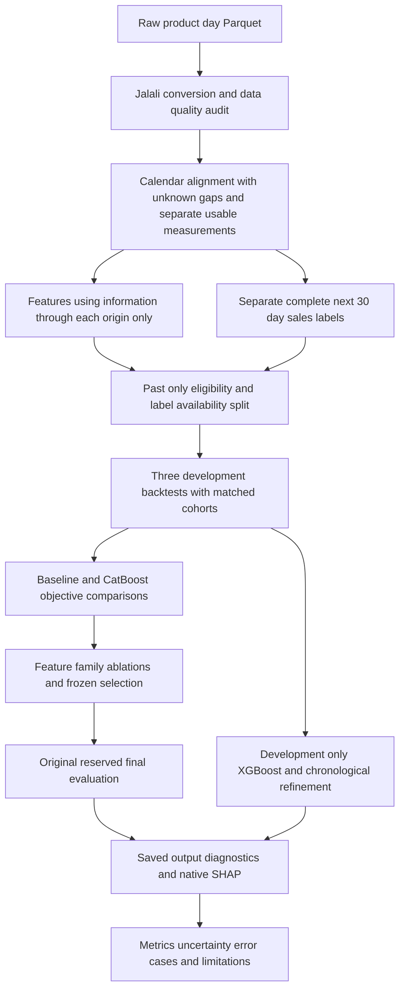

# Retail demand forecasting technical report

This project predicts each product's total unit sales over the next 30 days from daily retail records. It implements data auditing, preprocessing, competitive feature engineering, baseline comparison, temporal validation, and statistical model evaluation. The selected CatBoost model improved final-horizon WAPE from **19.21% to 17.73%**, but increased RMSE and retained a negative forecast bias. The evidence supports keeping it as the current reference for absolute-error accuracy while investigating extreme misses and validating performance over more periods before deployment.

The [task brief](data/Pricing%20Data%20Science%20Task.docx) asks for a short technical note and a workflow diagram. This README expands that note to include the completed XGBoost/refinement experiments and statistical diagnostics. Numbers below come from saved outputs; proposed follow-up experiments are identified separately.

Open the [notebook in src/okala](src/okala/main.ipynb) for the full analysis and preserved outputs. The [original notebook](data/retail_demand_eda.ipynb) remains available. The notebook in `src/okala/main.ipynb` uses project-relative imports and data paths. Its saved outputs can be reviewed without execution.

## Task and forecasting contract

The input is a product-by-day Parquet file containing sales, recorded price, discount, closing inventory, the number of stores with stock, brand, and five category levels. Although the assessment concerns pricing data science, the implemented target is **observed sales**, rather than price optimization, causal price elasticity, or unconstrained demand. Lost sales cannot be recovered from these measurements alone.

A forecast is issued after day `T` has been fully reported. Its target is:

```text
y(product, T) = sum of recorded sale_qty from T+1 through T+30
```

Every predictor must be available by `T`. Prices, discounts, inventory, and competitor conditions inside the future horizon are unknown; calendar dates are known. The implementation forecasts the 30-day total directly. This matches the requested business output, avoids recursively feeding predicted daily sales into later predictions, and keeps the experiment small. It does not produce a daily replenishment profile. A daily model followed by aggregation could represent day-specific promotions and availability, but would require reliable future inputs and separate validation of daily errors and their aggregation.

## Data understanding and preprocessing

The source contains **902,438 observations, 1,235 products, and 732 calendar dates**, spanning **2024-09-21 to 2026-09-22**. Dates are supplied in the Jalali calendar; the notebook explicitly converts them before constructing calendar windows. The corrected data has **zero source nulls and zero globally absent dates**. Nevertheless, there are **1,499 absent product-day records within observed product lifetimes**, affecting 309 products. Missing fields and missing records are different problems.

Recorded zero sales account for **2.54%** of observations. Sales and inventory contain fractional values, so they remain floating point. All products have multiple recorded prices and discounts. These rules distinguish observations from assumptions:

| Situation | Implemented handling and reason |
|---|---|
| Recorded zero sales | Retain zero as an observed outcome. |
| Absent product-day record | Retain an unknown observation in the calendar-aligned view. Do not fabricate zero sales, inventory, price, or discount. |
| Incomplete historical window | Use observed-day denominators for observed-day means. Retain counts, coverage, and ages in the extracted collection; complete-calendar sums remain unknown. |
| Incomplete future label | Require all 30 daily sales observations. Do not label a partial sum as a complete month or extrapolate it into a target. |
| Product boundaries | Do not fill before first observation or infer historical discontinuation from a product's eventual last record. |
| Zero recorded price | Treat it as unknown usable price, preserving the raw value and quality indicator. |
| Suspect inventory | Preserve raw values and sales; mask the inventory measurement only in the usable-stock view. |

All **22,957 zero-price observations coincide with zero-sales observations**, and vice versa. This does not establish that products were offered free. Last positive prices are retained as historical measurements, with their ages, rather than confirmed current or future offers. No backward filling or interpolation uses a later price to repair an earlier observation.

Closing inventory is at least daily sales in every observed row, and **6,194 rows have equal stock and sales**. Five dates have this equality for every reported product. Positive equality is excluded from usable inventory summaries under a conservative quality rule, without deleting the sales outcome. There are also **2,635 positive-stock/zero-store disagreements**. These are flagged because stock and store counts may have different scopes. There are no recorded zero closing-stock observations in this source; the pipeline still preserves genuine zeros if supplied. These measurements cannot identify intraday stockout duration.

### Spikes and sparse histories

The exploratory spike flag compares each product's sales against its median plus `6 × 1.4826 × MAD`; an upper-quantile fallback handles zero MAD. It flags **12,464 rows**. These full-history statistics are descriptive EDA only and never enter model inputs or target cleaning. A spike may represent promotion, seasonality, distribution expansion, or reporting error. The primary experiment retains observed sales rather than assuming every spike is invalid. Any future learned anomaly rule must use only past observations within each fold.

The pilot cohort requires at least **90 days since first observation**, at least **86 recorded days in the trailing 90 days** (95% coverage rounded upward), and a record within the latest seven days. This eligibility rule depends only on the past. A dedicated cold-start fallback based on category/brand rates remains future work; current scores do not establish cold-start performance.

Intermittent products remain eligible when they satisfy this rule. Zero rates, positive-day counts, variability, and intermittency proxies describe them. The later refinement investigates products with at least a 20% recorded zero-sales rate over 90 days.

No global scaler or learned numeric imputation is fitted. The chosen tree models use numeric features in their existing units and retain missing values. Ratios with zero denominators remain unknown rather than receiving an arbitrary epsilon. A future linear or neural model would need fold-fitted imputation and scaling, with robust or log transformations considered for skewed positive inputs.

## Feature design

The pipeline extracts **215 declared model features**, including the proposed feature families. There are seven categorical identity/hierarchy inputs and 208 numeric or Boolean candidates. Keys, target values, target completeness, and history eligibility are excluded from the model input whitelist.

| Feature family | Count | Content and intended signal |
|---|---:|---|
| Main | 12 | Product, brand, five category levels, and last-known sales, price, discount, inventory, and store coverage. |
| Aggregated history | 62 | Means, complete/observed sums, medians, standard deviations, extremes, and decayed means: compressed sales levels and operating conditions. |
| Difference and deviation | 5 | Sales relative to recent distributions, recent versus longer sales rates, and price/discount deviations. |
| Domain | 7 | Sales per stocked store, inventory-cover proxy, intermittency proxy, transformed price, and named calendar-date counts. |
| Temporal | 23 | Exact calendar lags and zero/positive-sales or discounted-day rates and counts. |
| Missingness and metadata | 43 | Coverage, ages, missing runs, usable-measurement counts, and price/stock quality indicators. |
| Velocity and acceleration | 6 | Fractional changes between disjoint weeks, first/second differences, and price/store-count changes. |
| Higher-order statistics | 16 | Skewness, excess kurtosis, IQR, tail spread, CV, positive-sales CV squared, entropy, and largest-day concentration. |
| Cyclical | 27 | Weekday/Jalali seasonal transforms and known calendar composition of the next 30 days. |
| Competition | 14 | Peer prices, discounts, availability/reporting, historical shares, relative rates, and peer trends. |
| **Total** | **215** | Full collection before selection and training-only constant removal. |

Aggregation windows are **7, 14, 30, 60, 90, and 180 days**. The 90-day eligibility requirement differs from the maximum aggregation window. An exact 364-day sales lag is also included when available. Statistics requiring positive variance or enough observations remain missing otherwise. Official holiday counts remain unknown because a verified calendar was not supplied. Spatial transforms are unsupported because the data contains no store identities or coordinates.

The selected model removes the **43 explicit missingness/metadata features**, leaving **172 declared inputs**; **170** remain after training-only constant/all-missing removal in the final fit. This does not remove the missing-data policy or imply that the model cannot use missing-value patterns. Related observation counts remain in other families, and tree missing-value handling still applies. Definitions and availability are in the [feature catalog](data/processed/feature_catalog.csv).

### Competitive features for substitutes

Products sharing their latest known `Level4` category are treated as candidate substitutes. Let `P_i` be other products known in product `i`'s category at the cutoff. These implemented features meet the assessment's requirement for at least five competitive signals:

| Feature | Definition at cutoff T | Business interpretation |
|---|---|---|
| Relative price | Own last positive, age-qualified price divided by median peer price. Exclude prices older than 30 days. | Relative recorded price position. |
| Fraction of peers cheaper | `(number cheaper + 0.5 × number tied) / number with usable prices`. | Competitive price rank, including ties. |
| Discount gap | Own recent discount minus mean recent peer discount, in percentage points; measurement age must be less than seven days. | Relative promotional intensity. |
| Peer availability rate | Peers reporting positive stocked-store counts on T divided by peers observed on T. | Breadth of reported alternatives; unknown peers are not asserted unavailable. |
| Historical sales share | Own complete trailing-30-day sales divided by category sales among products with complete trailing windows, including own sales. | Historical position within the reported assortment. |
| Sales versus peers | Own trailing-30-day observed sales rate divided by mean peer rate, with peer coverage at least 95%. | Product strength relative to the category. |
| Peer fractional trend | Mean peer seven-day rate divided by mean peer 30-day rate, minus one; both windows require at least 95% coverage. | Recent momentum among alternatives. |

Other competitive inputs provide peer counts, reporting/completeness support, and reference price/discount levels. Comparisons exclude the focal product; sales share includes it in the category denominator by definition. Singleton groups and undefined ratios remain missing. These signals are **historical and available at forecast issuance**, assuming day T's reporting is complete. None requires actual future peer outcomes. They are not future-known features.

Competitive inputs join the main tabular matrix. Their value is tested by removing the family under the same origins, labels, products, objective, and budget. Removing competition increased mean development WAPE from **19.52% to 20.43%**, a **0.91 percentage-point deterioration**, and was worse on all three folds. This supports conditional predictive value in the full collection. It does not prove causal substitution: package sizes, pack counts, and unit-normalized prices are unavailable, and category membership is an imperfect substitute definition.

## Modeling and training design

The baseline predicts **30 times the trailing-30-day observed daily sales mean**. With complete history this equals the preceding 30-day total. With gaps it is an explicit rate-based forecast, not recovered historical data. This is a useful reference because product sales levels are persistent and the calculation is easy to explain and maintain.

The main model is a global **CatBoost regressor** across eligible product-origin samples. It combines identity/category information with nonlinear historical, competitive, and calendar interactions within a modest budget. A tabular foundation model or transformer was not tested, so no empirical superiority over those architectures is claimed. This experiment first establishes whether a practical boosted-tree approach adds value over a strong simple reference.

Static-as-of-cutoff identifiers, historical summaries, and future-known calendar inputs are distinguished in the catalog and concatenated for the tree model. Metadata uses only the latest value already observed. CatBoost uses native one-hot category splits with the threshold covering observed training cardinalities, avoiding label-derived categorical statistics. Constants and all-missing columns are removed using training rows only. Evaluation labels do not drive early stopping.

Each fit uses **300 trees, depth 6, learning rate 0.07, L2 regularization 5, seed 42, and eight CPU threads**. Three objectives were compared at this fixed budget:

| Full-feature objective | Mean development WAPE | Interpretation |
|---|---:|---|
| Raw sales MAE | **19.52%** | Best absolute-error result under the selection metric. |
| Raw sales RMSE | 20.46% | Emphasizes large misses; slightly lower development RMSE than raw MAE, but higher WAPE. |
| Log1p sales RMSE | 22.57% | Compresses large outcomes and changes relative error emphasis; did not improve overall WAPE. |

Log-model forecasts use `expm1` without a smearing correction. All model forecasts are clipped at zero after prediction. Raw MAE was selected by equal-fold mean development WAPE, followed by ten drop-one-family ablations. Removing explicit metadata improved WAPE from **19.52% to 19.25%**, helping all three folds. Removing velocity/acceleration or main features worsened full-model WAPE by **0.97** and **1.13 points**, respectively. Correlated information can remain in other families, so these are conditional contributions. The [ablation table](data/modeling/ablation_summary.csv) records every result.

A dedicated history-length comparison has **not** been run. Multiple summaries allow different timescales but do not establish an optimal history configuration. A follow-up should compare, for example, 30/60/90/180-day histories on the same eligible evaluation products using development folds only. Changing cohort eligibility simultaneously would confound the comparison.

## Temporal validation and leakage prevention

Training origins are normally seven days apart, supplemented by fixed evaluation origins. Each sample's features end at its origin `t`; its label covers `t+1` through `t+30`. For evaluation at `T`, only complete training labels with **`t+30 <= T`** are permitted. Earlier training labels can overlap one another, but none reaches into the evaluated future interval. Random splitting would break this contract because adjacent samples share histories and outcomes.

The design uses three consecutive, nonoverlapping development horizons and one reserved final horizon, retraining with expanding available history:

| Role | Forecast origin | Target interval | Evaluation products | Training samples |
|---|---|---|---:|---:|
| Development 1 | 2026-05-25 | 2026-05-26 to 2026-06-24 | 1,233 | 86,895 |
| Development 2 | 2026-06-24 | 2026-06-25 to 2026-07-24 | 968 | 93,062 |
| Development 3 | 2026-07-24 | 2026-07-25 to 2026-08-23 | 1,191 | 97,902 |
| Final test | 2026-08-23 | 2026-08-24 to 2026-09-22 | 1,232 | 105,173 |

The horizon matches the business target. Three windows provide several recent operating conditions without an extensive search, but do not represent year-round seasonality. All candidates share the evaluation cohort within each window. Of 1,235 known products, 266 lack complete future outcomes in development 2. The [coverage report](data/processed/backtest_plan.csv) records exclusions; incomplete-label exclusions account for approximately **1.47% of history-eligible trailing sales volume** in that fold. Complete-case evaluation may still be selective.

Concrete leakage risks and protections are:

- **Future labels across the split:** purge training samples whose target end is after the evaluation cutoff.
- **Future price repair or peer information:** build own/peer measurements using dates at or before the sample origin; never backward-fill from later records or use eventual assortment membership.
- **Outcome metadata as input:** keep targets separate and whitelist features, excluding completeness and target-end fields.
- **Global fitted preprocessing or target-based category statistics:** remove constants within training only and avoid label-derived categorical encodings.
- **Future-derived anomaly thresholds or status:** keep full-history spike flags descriptive and avoid inferring historical status from eventual last-record dates.

Prefix-invariance checks compare historical feature snapshots from the full source with snapshots from source truncated at the cutoff. The original final selection was frozen before final scoring. However, full-dataset EDA preceded that experiment, and later diagnostics inspect final errors. The final horizon is not a blinded external test; additional decisions now need fresh confirmation data.

## Evaluation results

The primary selection metric is **WAPE**, `100 × sum(abs(prediction − actual)) / sum(actual)`: aggregate absolute error relative to sales volume. **MAE** is average absolute error in source sales units; on a fixed cohort it ranks models identically to WAPE. **RMSE** emphasizes large misses. **sMAPE** averages `200 × abs(error) / (abs(prediction) + abs(actual))` per product, assigning zero when both values are zero; it adds a relative-error view sensitive to small products. Signed bias is `100 × sum(prediction − actual) / sum(actual)`; negative means underforecasting. WAPE is undefined for an entirely zero-volume cohort.

### Baseline versus the selected model

| Evaluation window | Baseline WAPE | Selected CatBoost WAPE |
|---|---:|---:|
| Development 1 | 23.43% | **19.54%** |
| Development 2 | **20.70%** | 21.96% |
| Development 3 | 17.66% | **16.25%** |
| Equal-fold development mean | 20.60% | **19.25%** |

The model improves two development folds and loses one. Development 2 also shows **−14.34% bias** and reduced label coverage, so the mean alone would hide a material weakness.

The reserved final comparison uses the same **1,232 products** and **30,647,285.57 observed sales units**:

| Final-horizon metric | Baseline | Selected CatBoost |
|---|---:|---:|
| WAPE | 19.21% | **17.73%** |
| MAE | 4,778.66 | **4,410.88** |
| RMSE | **14,165.58** | 17,025.70 |
| sMAPE | 27.28% | **25.55%** |
| Signed bias | **−5.30%** | −6.24% |

The **1.48 percentage-point WAPE gain** is approximately a **7.7% reduction in aggregate absolute error**. The model beats baseline for **62.4% of products**, and median absolute error falls from approximately **975 to 806 units**. Nevertheless, RMSE and aggregate underforecasting worsen. It is preferable under the declared absolute-error objective; these results do not establish superiority under every inventory or service-level cost function. See the saved [final metrics](data/modeling/final_metrics.csv) and [per-product predictions](data/modeling/final_predictions.parquet).

### XGBoost and refinement

A separate development-only experiment compares the weekly CatBoost control with five-day rotating training origins, CatBoost and XGBoost, three losses, and full/reduced feature sets. It also evaluates chronological model/baseline blending and sparse routing. There are **13 base candidates**, plus baseline and the sequential policy. The five-day schedule adds roughly 40% more origins and changes weekday representation, so its effect is not isolated from sample count.

| Candidate or policy | Mean development WAPE | Mean development RMSE |
|---|---:|---:|
| Original weekly CatBoost MAE without explicit metadata | **19.25%** | 14,646.96 |
| Sequential calibrated policy | 19.48% | 15,026.41 |
| Rotating CatBoost MAE without explicit metadata | 20.16% | 14,843.18 |
| Best static XGBoost by development WAPE, raw MAE without explicit metadata | 20.37% | 17,200.28 |
| Baseline | 20.60% | **13,254.55** |

Rotating origins did not improve the matched CatBoost configuration and were worse in all three windows. XGBoost did not beat the weekly control under this budget; this does not rule out a separately tuned XGBoost model. The algorithms have matched tree counts and headline settings, not equivalent training procedures or equal wall-clock budgets. XGBoost uses CPU `hist` with native categorical splits and training-only category vocabularies; prediction-only categories become missing.

Three earlier calibration horizons have forecast origins **2026-02-24, 2026-03-26, and 2026-04-25**. Each reported policy uses only completed earlier horizons. Sparse routing minimizes calibration sMAPE subject to WAPE no worse than 105% of baseline. Main model/baseline weights are compared over `0, 0.25, 0.5, 0.75, 1`, with calibration RMSE and sMAPE guardrails at 105% of baseline. These tolerances are experiment choices, not established business costs or guarantees on later periods.

All selected main-model weights were **1**, so nontrivial blending was not selected. Sparse routing reduced equal-fold sparse sMAPE from **68.06% to 64.69%**, but development 2 worsened and segment sizes were only **59, 12, and 27 products**. The whole policy did not beat the original model, although bias improved from **−7.05% to −5.99%**. The weekly CatBoost remains the reference. See the [refinement leaderboard](data/refinement/leaderboard.csv).

This experiment reads source observations only through **2026-08-23**. It does not score the August 24–September 22 final outcomes, and preserves all original model/result artifacts. No XGBoost final-test result is claimed.

## Statistical diagnostics and model understanding

Diagnostics analyze saved predictions and native explanations without retraining, selecting a new model, or optimizing alert thresholds. They cover **47 model/horizon regression comparisons**, **329 derived alert comparisons**, and native SHAP for the final CatBoost and matched last-development CatBoost/XGBoost models.

### Distributional agreement and uncertainty

Prediction-minus-actual marginal **SMD is −0.027** and empirical **KS distance is 0.029** on the final CatBoost cohort. Marginal SMD uses the mean difference divided by the square root of the average sample variances. Paired residual standardization is reported separately; constant-feature shifts have undefined SMD rather than artificial large effects. Small marginal distances can coexist with large product errors because product scales vary greatly. They do not override **17.73% WAPE** or **−6.24% bias**.

Paired resampling of **88 Level4 category blocks**, with 2,000 bootstrap draws, gives a **95% WAPE-gain interval of −0.77 to +3.74 percentage points**. A category sign-flip comparison with 5,000 draws gives **p = 0.207**. The interval crosses zero, so the procedure does not establish a clear improvement beyond the point estimate; it also does not establish equivalence. These results are conditional on one fixed horizon and assume category blocks are suitable resampling units. Shared shocks can violate block independence. They do not quantify uncertainty across future months. Holm adjustment is applied across model comparisons within a horizon. Independent-sample KS p-values are omitted because pairing and dependence undermine that interpretation.

### Confusion matrices for defined events

Regression has no intrinsic TN, FP, FN, or TP. The analysis defines illustrative alerts. High demand means reaching the historical 75th-percentile threshold, **20,919.07 units**, estimated from the cross-section of each product's latest completed historical 30-day target available at the cutoff. Growth and decline compare actual and forecast totals with the known trailing-rate baseline; zero-reference ratios are excluded. These are forecast-derived decisions, not separately trained classifiers, calibrated probabilities, or stockout labels.

| Final CatBoost event | TN | FP | FN | TP | Precision | Recall | ROC AUC |
|---|---:|---:|---:|---:|---:|---:|---:|
| High demand | 899 | 5 | 31 | 297 | 98.3% | 90.5% | 0.995 |
| Growth of at least 25% | 939 | 33 | 192 | 68 | 67.3% | 26.2% | 0.774 |
| Decline of at least 25% | 1,018 | 42 | 91 | 81 | 65.9% | 47.1% | 0.804 |

High-demand score KS is **0.955**, but the baseline already has high-demand AUC **0.990**. Much of this success reflects persistent product scale. Low growth recall is stronger evidence of difficulty anticipating changes. Operational alert thresholds require business costs and fresh validation.

SMD and KS also compare input features for **FP versus TN**, **FN versus TP**, and products where model absolute error is worse versus better than baseline. For high-demand misses, historical sales and stocked-store coverage tend to be lower than for true positives. These associations condition on the event; they are not causal drivers. Only five high-demand false positives are available, making that profile particularly fragile. Actual SKU cases are exported for investigation.

### Error concentration and explanations

The **13 products with the largest squared errors account for 80.4% of total squared error**. This explains why typical absolute accuracy improves while RMSE worsens. The raw-scale model produces **23 zero forecasts for products with positive realized sales**, through clipping negative native predictions. Category and SKU tables expose these cases.

Native SHAP attributes approximately **71.5% of the sum of mean absolute feature contributions** to aggregated history in final CatBoost predictions. Prominent inputs include complete seven-day sales, seven-day half-life decayed sales, 14-day means, recent medians, last usable stock, and last observed sales. The model primarily learns historical sales level and product scale, with additional signals from trends, competition, and calendar structure. Correlated features can share or cancel attribution; SHAP ranks do not replace ablation evidence.

SHAP sums are checked against native output, with zero clipping reported separately. Dependence plots and local explanations describe the fitted function; they do not estimate causal price or inventory effects. Further pricing decisions require stronger semantic and causal evidence.

See the [statistical summary](data/analysis/regression_statistics.csv), [paired uncertainty analysis](data/analysis/paired_cluster_inference.csv), [alert results](data/analysis/alert_statistics.csv), [feature error profiles](data/analysis/error_feature_profiles.csv), and [SHAP summaries](data/analysis/shap_global.csv). Section 16 contains the plots and interpretation.

## Workflow diagram



## Recommendation and remaining experiments

Keep weekly **CatBoost/raw-MAE with 172 declared inputs** as the current WAPE-oriented reference, alongside baseline. Its observed absolute-error gain is useful, but worse RMSE, negative bias, the concentrated tail, and the uncertainty interval prevent an unconditional deployment recommendation.

Prioritize investigating extreme SKU/category errors and verifying price/inventory semantics with the data owner; validating additional chronological horizons; comparing history windows on a common cohort; and testing tail-aware or quantile losses against explicit understock/overstock costs. A raw-stock versus conservative-stock ablation, verified holiday calendar, and short-history fallback remain uncompleted experiments. Sparse routing deserves further validation if relative accuracy for small products matters. New choices should use development data and receive fresh confirmation rather than repeatedly reusing the inspected final horizon.

## Reproducibility and repository guide

The [notebook](src/okala/main.ipynb) contains EDA, the preprocessing contract in Section 11, features in Section 12, feature counts in Section 13, baseline/ablation experiments in Section 14, refinements in Section 15, and diagnostics in Section 16. Saved outputs can be inspected without running the pipeline. The copied notebook resolves project `src/` and `data/` directories; it does not expect the dataset beside the notebook.

| Location | Purpose |
|---|---|
| [features.py](src/okala/features.py) | Preprocessing, cutoff-safe features, complete targets, splits, and exports. |
| [modeling.py](src/okala/modeling.py) | Baseline, CatBoost objectives, ablations, frozen selection, and original final evaluation. |
| [refinement.py](src/okala/refinement.py) | Development-only XGBoost, cadence comparison, blending, and sparse routing. |
| [diagnostics.py](src/okala/diagnostics.py) | Statistics, category-cluster inference, derived alerts, and native SHAP. |
| `data/processed/` | Features/targets, catalog, backtest coverage, and source/configuration manifest. |
| `data/modeling/` | Original selection, metrics, predictions, checkpoints, and final evaluation model. |
| `data/refinement/` | Candidate scores, chronological policies, development models, and preservation audit. |
| `data/analysis/` | Statistical tables, errors, explanations, plots, and provenance. |
| [tests](tests) | Behavioral checks for features, leakage boundaries, models, refinements, and statistics. |

### Optional execution commands

These commands reproduce the work; they were not executed to prepare this report. Run them from the `okala` project root. Python 3.13 or later is required; [pyproject.toml](pyproject.toml) and [uv.lock](uv.lock) declare dependencies and the locked environment. Supply the assessment data at `data/candidate_dataset.parquet`.

```bash
uv sync --group dev

PYTHONPATH=src .venv/bin/python -m okala.features \
  --data data/candidate_dataset.parquet --output-dir data/processed

PYTHONPATH=src .venv/bin/python -m okala.modeling \
  --data-dir data/processed --output-dir data/modeling

PYTHONPATH=src .venv/bin/python -m okala.refinement \
  --source data/candidate_dataset.parquet --data-dir data/processed \
  --output-dir data/refinement --iterations 300 --threads 8

PYTHONPATH=src OPENBLAS_NUM_THREADS=4 .venv/bin/python -m okala.diagnostics

PYTHONPATH=src .venv/bin/python -m unittest discover -s tests -v
```

Installed entry points are `okala-features`, `okala-modeling`, `okala-refine`, and `okala-analyze`. The last completed verification had **27 passing tests**. This README revision does not rerun them or retrain models.

Features and targets join on `forecast_origin` and `product_id`. Always select inputs using the manifest's `model_feature_columns` and fitted model's ordered `used_feature_columns`, rather than passing an entire joined table. The feature-stage manifest's statement that no modeling was performed describes that extraction stage; subsequent model provenance resides in modeling/refinement outputs.

`data/modeling/test_model.cbm` is the selected evaluation model fitted with labels available by **2026-08-23**, not a production refit through the latest date. Load it with column order from `final_fit.json` and objective from `selection.json`. Exported predictions already include inverse transformation where relevant and nonnegative clipping. Latest-date feature rows at **2026-09-22** have unknown future targets; building them does not constitute a production forecast or a new final evaluation.

Experiment fingerprints include input artifacts, configuration, versions, and implementation. Compatible runs reuse checkpoints. Refinement and diagnostics preserve upstream hashes; diagnostics verified **391 modeling/refinement files** unchanged. Generated result directories are ignored by version control, so a source-only checkout must regenerate or separately obtain those artifacts before opening linked tables and figures.
